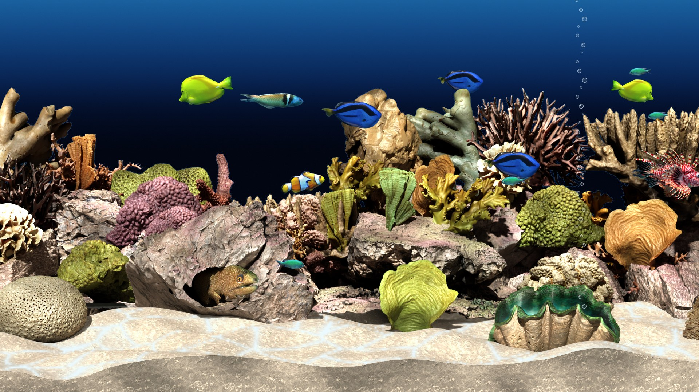
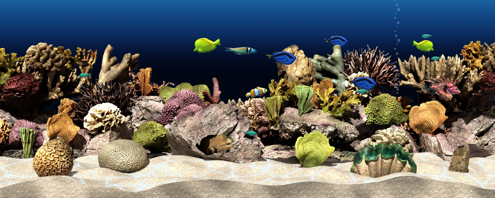

# Tranquil Reef

A reef aquarium screensaver for Roku.



Tropical fish swim through a coral reef built from museum 3D scans of real corals. They turn around
in real 3D, and their fins flex as they swim. A school of chromis turns together. A moray eel slides
out of its cave, looks around and backs in again. A giant clam breathes, and now and then it flinches
shut. Caustic light ripples over the sand. Yellow tangs, clownfish, wrasses and chromis live in the tank, and
eight more (three angelfish, two butterflyfish, a lionfish, a parrotfish and a puffer) take turns
visiting it, one at a time. The view pans slowly from one end of the tank to the other:



## Installing it on your Roku

1. Download **Tranquil Reef Installer.exe** from the [Releases](../../releases) page and run it (Windows).
2. Follow its three steps:
   - **Turn on developer mode on the Roku.** On the remote press Home ×3, Up ×2, Right, Left, Right, Left, Right. Choose *Enable installer and restart*, then make up a developer password.
   - **Choose your Roku.** The installer finds the Rokus on your network.
   - **Type the developer password and click Install.**
3. On the Roku, go to **Settings → Theme → Screensavers → Tranquil Reef**.

Developer mode only lets you install channels from your own computer. It changes nothing else on the
Roku. The installer never stores your password. A Roku keeps one channel installed this way at a time,
so installing Tranquil Reef replaces any other channel you sideloaded.

Not on Windows? `TranquilReef.zip` is on the Releases page too. With developer mode on, open
`http://<your Roku's address>` in a browser, sign in as `rokudev` with your developer password, and
upload the zip.

## How it is made

The tank is rendered in [Blender](https://www.blender.org) and played back on the Roku as layers and
sprite sheets. The Roku has 100 MB of texture memory, but its own home-screen images can keep more
than 20 MB of it, so the reef is kept to about 71 MB at its peak: the visiting fish take turns so
that only one visitor's sheet is loaded at a time, and the moray's sheet is loaded only while it is
out of its cave. When the reef starts as a screensaver, the home screen can still be holding
much more than that, so the reef loads its pictures one at a time, the background first, and leaves
out what does not fit (the visitors and the moray first) until there is room again.

| Part | What it does |
|---|---|
| `blender/scanreef.py` | The tank: rock and coral scans placed on mounded gravel, the lighting, the moray's cave, the giant clam; renders the still, the clam frames and the moray frames |
| `blender/reeftank.py`, `reef3d.py`, `common.py` | The gravel bank, materials, water and lights it builds on |
| `blender/photo3d.py` | Fish from photos: builds a 3D body from a cut-out photo, bends it along a swimming wave and renders the swim cycle and the turn-around |
| `blender/model3d.py` | Fish from 3D models (glTF): the same swim and turn as the photo fish |
| `photos/` | Finds, downloads and cuts out the fish photos (`find_photos.py`, `prepare.py`, `inflate.py`), and composes the water (`compose.py`) |
| `build.py` | Cuts the render into layers, makes the caustics and sprite sheets, and packages the Roku channel |
| `template/` | The Roku channel itself (BrightScript and SceneGraph) |
| `installer/` | The Windows installer |

### Building from source

You need Python 3 with Pillow, numpy and scipy, Blender 4.2 or newer (5.2 was used) with a GPU, and,
for the installer, PyInstaller.

The scans, models and textures are not in this repository (they are large, and they belong to their
authors). [CREDITS.md](CREDITS.md) lists where each one comes from. They go in `scans/`:
`scans/si/` (Smithsonian corals, the Medium-quality GLB of each), `scans/ph/<name>/` (Poly Haven rocks,
glTF), `scans/nhmw/` (the giant clam) and `scans/fish/` (the fish models). `fetch_textures.py`
downloads the Poly Haven surface textures, and `photos/prepare.py` the fish photos.

```
python fetch_textures.py
python photos/prepare.py
sh render_all.sh "C:/path/to/blender.exe"          # the photo fish
blender -b --factory-startup -P blender/scanreef.py -- textures work/tankscene 192
blender -b --factory-startup -P blender/scanreef.py -- textures work/tankscene 128 --clam
blender -b --factory-startup -P blender/scanreef.py -- textures work/tankscene 128 --clam --opaque
blender -b --factory-startup -P blender/scanreef.py -- textures work/tankscene 128 --moray
blender -b --factory-startup -P blender/scanreef.py -- textures work/tankscene 128 --moray --opaque
python photos/compose.py 3 --no-corals
python build.py
installer\build-installer.bat
```

`render_all.sh` also lists the `model3d.py` command for each 3D-model fish. `out/TranquilReef.zip` is
the channel. To sideload it during development, run `deploy.ps1` (it reads the password from
`$env:ROKU_DEV_PASSWORD`).

The pictures above are made by `build.py` from the channel's own layers and sprites.

## License

The code is MIT. See [LICENSE](LICENSE).

The artwork made from other people's scans, models and photos keeps their licenses, listed in
[CREDITS.md](CREDITS.md). Almost all are public domain, CC0 or CC BY. The one exception is the giant
clam, a CC BY-NC model: Tranquil Reef is free and non-commercial, and anyone reusing it commercially
must replace the clam (see CREDITS.md).
